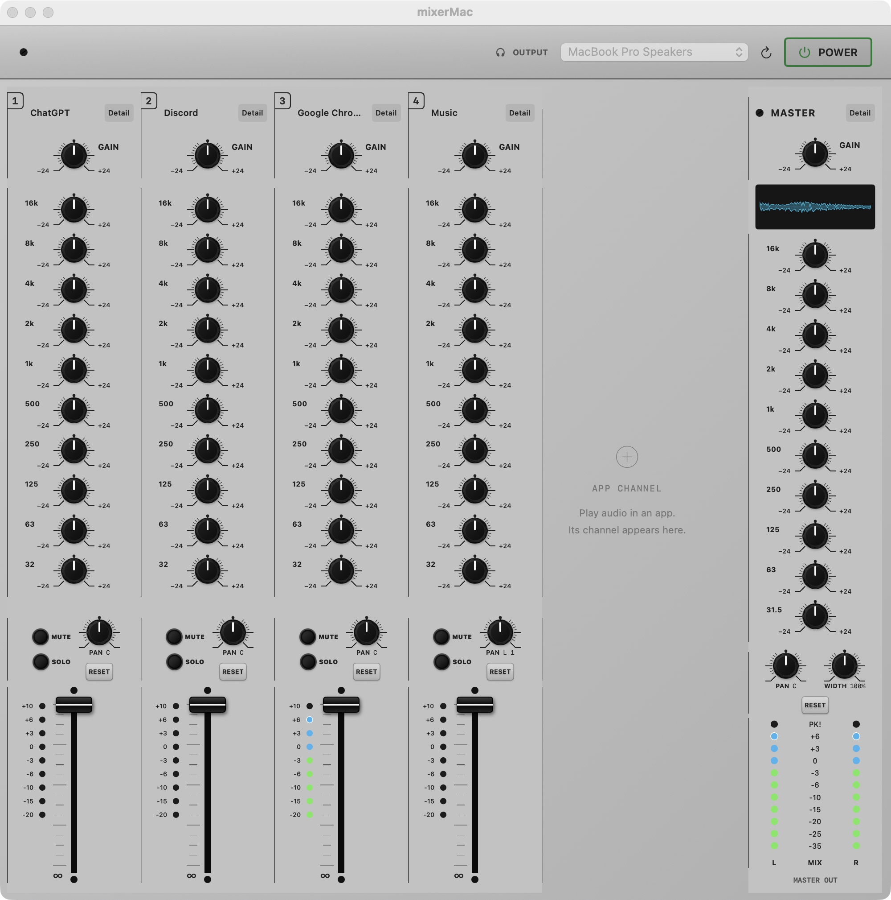
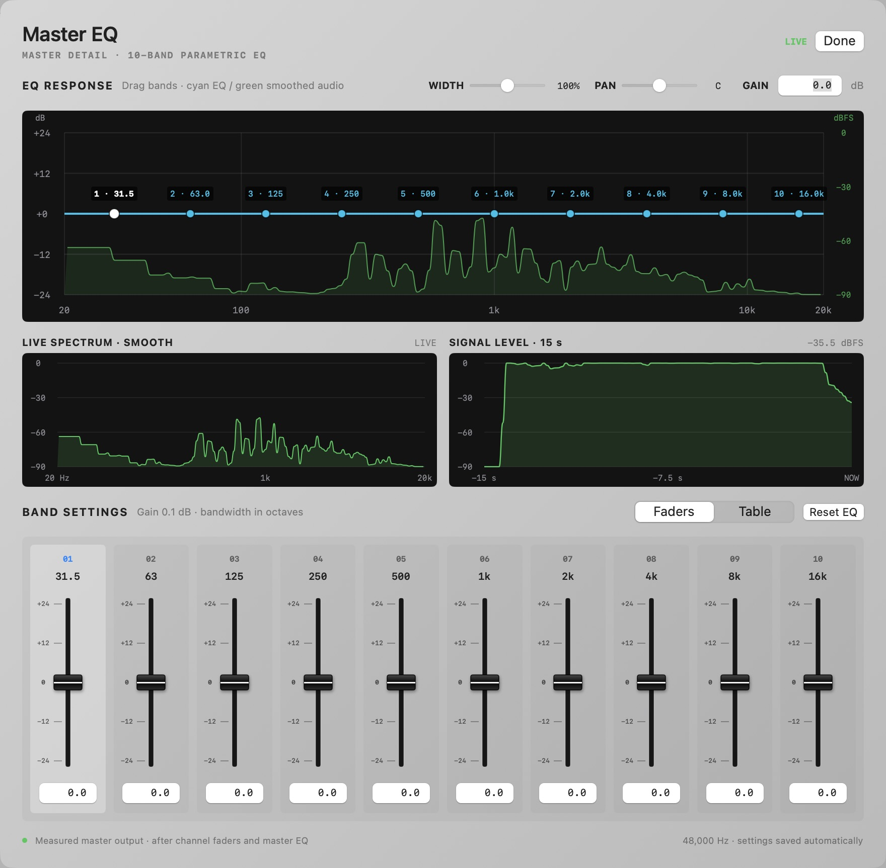

# mixerMac

[Website](https://jueuunn7.github.io/mixerMac/) · [Download](https://github.com/jueuunn7/mixerMac/releases/latest)

A native macOS audio mixer with per-application EQ, a shared master bus, and a console-style interface.

Adjust the sound of individual apps, fine-tune the combined output, and inspect the live spectrum without installing a separate audio driver. All audio processing happens locally; mixerMac does not record or upload your audio.

## Download and install

**Requirements:** macOS 14.2 or later. The current prebuilt app is for **Apple Silicon** Macs.

1. Open this repository's **Releases** page.
2. Download **`mixerMac-macOS.zip`** from the release assets. The GitHub-generated source archives are for development.
3. Extract the ZIP and move **`mixerMac.app`** into your **Applications** folder.
4. Open the app and allow audio capture when macOS requests access.

You do not need Xcode, command line tools, or the optional virtual driver to use the prebuilt app.

The current build is not notarized by Apple, so macOS may require you to explicitly allow the first launch. Audio capture must also be permitted for processing and live analysis to work.

## The console



Each detected application gets an independent channel. The master strip controls the combined output.

- **Ten-band EQ per app and on the master**, with −24 to +24 dB band gain.
- **Channel and master GAIN**, adjustable from −24 to +24 dB.
- **Channel volume faders**, mute, solo, and stereo pan.
- **Master PAN and WIDTH**, with mono at 0%, original stereo at 100%, and wider stereo up to 200%.
- **Live level meters**, peak hold, and a master waveform display.
- **Saved settings**, including channel controls, master controls, output selection, and the last power state.

### Getting started

1. Play audio in an application so its channel can be detected.
2. With **POWER** off, select your output device.
3. Turn **POWER** on and adjust the app's GAIN, EQ, or fader.
4. Use the master GAIN and EQ to adjust the combined output.

Turning POWER off restores normal application playback. If you quit while processing is on, mixerMac attempts to resume after discovering your output device and applications on the next launch.

### Controls

| Control | Behavior |
| --- | --- |
| GAIN | Adjusts level; 0 dB leaves it unchanged. |
| Channel fader | Silence at the bottom, unity gain (0 dB) at the top. |
| MUTE / SOLO | Silences a channel or listens to selected channels. |
| PAN | Stereo balance; center preserves the original stereo signal. |
| Master WIDTH | 0% mono, 100% original stereo, 200% expanded side signal. |
| RESET | Returns EQ band gains to 0 dB. Channel RESET is below PAN; master RESET is below PAN and WIDTH. |
| Detail | Opens the EQ response, audio analysis, band faders, and numeric editor. |

Drag a knob vertically to adjust it. Double-click a knob to restore its neutral value: 0 dB for gain/EQ, center for PAN, and 100% for WIDTH.

EQ boosts and gain increases are applied directly. There is no automatic gain compensation or output limiter; lower master GAIN if the combined output reaches full scale.

### Level meters

The channel meter measures after channel EQ and before the fader. Displayed 0 corresponds to **−14 dBFS**. The red channel **+10** LED starts at **−4 dBFS**, indicating reduced headroom rather than clipping.

The master **PK** indicator starts at **0 dBFS**, the digital full-scale boundary. Peak markers hold for 1.5 seconds. Frequent channel warnings can occur with loud source material; a sustained master PK indication calls for reducing output gain.

## EQ Detail

Open **Detail** on an application channel or the master to inspect the EQ response and the measured audio spectrum together.



- Drag band points on the response graph or use the **Faders** editor.
- Switch to **Table** to edit frequency, gain, and bandwidth numerically.
- Inspect the live spectrum and 15-second signal history.
- Adjust GAIN and PAN; master Detail also includes WIDTH.

The response graph queries the same EQ configuration used for playback, including gain. Visualization smoothing is fixed at 50%. Settings save automatically as you edit.

## Build from source

Development requires macOS 14.2 or later and a Swift 6 toolchain with Apple Command Line Tools or Xcode.

```sh
# Build the app bundle and launch it.
./script/build_and_run.sh --verify

# Or compile the executable without launching.
swift build -c release
```

The bundle is created at `dist/mixerMac.app`. The build-and-run script closes an existing mixerMac process before rebuilding. To use a debug build:

```sh
MIXERMAC_BUILD_CONFIGURATION=debug ./script/build_and_run.sh --verify
```

Run the app bundle for interactive use; it supplies the audio capture usage descriptions required by macOS.

### Tests

```sh
./script/test.sh
./script/test_audio_bridge.sh
```

The Swift suite covers graph validation, externally registered sources/effects, rendered routing, EQ, master gain, meters, stereo controls, recovery, persistence, and migration of saved settings. Native bridge tests cover buffering, neutral-signal preservation, resampling, and channel handling with AddressSanitizer and UndefinedBehaviorSanitizer enabled.

### Source layout

| Location | Purpose |
| --- | --- |
| `Sources/MixerCore/` | Generic parameters, nodes, channels, buses, validated routing, and snapshots |
| `Sources/MixerStandardNodes/` | Console presets, standard effects, legacy settings, and display scales |
| `Sources/MixerAudio/` | Shared graph playback, source/effect registries, session recovery, capture, and analysis |
| `Sources/mixerMac/` | SwiftUI console, bindings, and window visibility |
| `Sources/mixerMacDSP/` | Native audio bridge, buffering, and sample processing |
| `Tests/MixerCoreTests/` | Generic core behavior, graph validation, and ownership tests |
| `Tests/MixerStandardNodesTests/` | Standard preset behavior and snapshot tests |
| `Tests/ExtensionFixtures/`, `Tests/AudioExtensionFixtures/` | Separate modules proving extension contracts |
| `Tests/mixerMacTests/` | Audio, persistence, recovery, and core integration tests |
| `Resources/` | App icon artwork and macOS icon bundle |
| `docs/assets/` | Logo and screenshots used in this README |
| `Driver/` | Optional experimental virtual audio driver and native tests |
| `script/` | Build, test, packaging, and icon rendering helpers |

See [the architecture guide](docs/architecture.md) for module responsibilities and headless verification.

### Release packaging

The downloadable app is a macOS bundle. Archive the bundle as a ZIP before attaching it to a GitHub release:

```sh
mkdir -p outputs
ditto -c -k --sequesterRsrc --keepParent dist/mixerMac.app outputs/mixerMac-macOS.zip
```

Upload **`mixerMac-macOS.zip`** as a release asset. Users extract it to get **`mixerMac.app`**. The local packaging workflow does not provide a Developer ID signature or Apple notarization.

## Optional driver

The `Driver/` directory contains an experimental virtual audio device for separate routing development. It is not required for the application mixer and is not installed by the app. See [Driver/README.md](Driver/README.md) for its own build and installation instructions.

## License

Original mixerMac code and artwork are available under the [MIT license](LICENSE). The optional driver includes Apple sample code under its original MIT notice; see [THIRD_PARTY_NOTICES.md](THIRD_PARTY_NOTICES.md) and [Driver/LICENSE.txt](Driver/LICENSE.txt).
